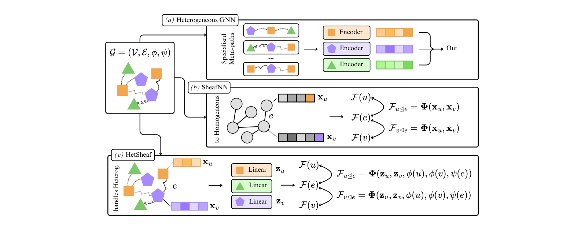
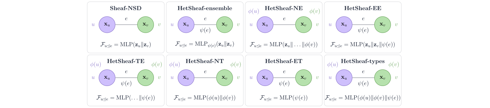

<div align="center">

# Heterogeneous Sheaf Neural Networks

[Luke Braithwaite](https://scholar.google.com/citations?user=gs4Ku0YAAAAJ)<sup>1,‡</sup>,
[Alessio Borgi](https://scholar.google.com/citations?hl=it&user=Ds4ktdkAAAAJ)<sup>1,3,‡,†</sup>,
[Gabriele Onorato](https://www.gabrieleonorato.it/)<sup>2,‡,†</sup>,
[Kristjan Tarantelli](https://it.linkedin.com/in/kristjan-tarantelli-b805a3234)<sup>3,‡</sup>,
[Francesco Restuccia](https://scholar.google.com/citations?user=mg__NBAAAAAJ)<sup>2</sup>,
[Fabrizio Silvestri](https://scholar.google.com/citations?user=pi985dQAAAAJ)<sup>3</sup>,
[Pietro Liò](https://scholar.google.com/citations?user=4YhNJBEAAAAJ)<sup>1</sup>

<sup>1</sup>University of Cambridge · <sup>2</sup>Northeastern University · <sup>3</sup>Sapienza University of Rome

<p>
  <a href="mailto:alessio.borgi@uniroma1.it">alessio.borgi@uniroma1.it</a>,
  <a href="mailto:ab3352@cam.ac.uk">ab3352@cam.ac.uk</a>,
  <a href="mailto:onorato.g@northeastern.edu">onorato.g@northeastern.edu</a>
</p>

<p><sup>‡</sup>Equal contribution &nbsp;&nbsp; <sup>†</sup>Corresponding authors</p>

#### [NeurIPS 2026 Workshop on Symmetry and Geometry in Neural Representations (NeurReps)](https://neurreps.org/)
#### Proceedings Track, published in Proceedings of Machine Learning Research (PMLR)

</div>

<p align="center">
  <a href="https://neurreps.org/">
    
  </a>
  <a href="https://proceedings.mlr.press/">
    
  </a>
  <a href="https://github.com/alessioborgi/Heterogeneous-Sheaf-Neural-Networks">
    
  </a>
  <a href="https://www.python.org/downloads/release/python-3130/">
    
  </a>
  <a href="https://pytorch.org/">
    
  </a>
  <a href="LICENSE">
    
  </a>
  <!-- Add once available:
  <a href="https://arxiv.org/abs/XXXX.XXXXX"></a>
  <a href="https://openreview.net/forum?id=XXXX"></a>
  -->
</p>

---

## Overview 🚀

This is the *Official Implementation* of the paper *Heterogeneous Sheaf Neural Networks*, accepted at the
NeurIPS 2026 Workshop on Symmetry and Geometry in Neural Representations (NeurReps) and published in its
Proceedings Track (PMLR). 🚀

**HetSheaf** puts graph heterogeneity into the *data structure* instead of the architecture: every node type gets its own
input projection, and the restriction maps of a cellular sheaf are learned from node features, node types and edge types.
The resulting sheaf is processed by any sheaf network unchanged (NSD, SheafAN, PolyNSD).
**SheafPool** is a gauge-invariant readout (whitening → anchor alignment → invariant attention → stalk-space pooling →
late token → channel energies) that makes graph classification with sheaf networks well defined.

<p align="center"></p>

## Installation

Needs Python 3.13 and [uv](https://docs.astral.sh/uv/getting-started/installation/). Torch 2.8 and the PyG
extension wheels are pinned per platform (CPU on macOS, CUDA 12.8 on Linux/Windows).

```bash
git clone -b public https://github.com/alessioborgi/Heterogeneous-Sheaf-Neural-Networks.git
cd Heterogeneous-Sheaf-Neural-Networks
uv sync --group dev          # macOS: run  export LDFLAGS="${LDFLAGS/--no-as-needed/}"  first if linking fails
uv run wandb login           # or: export WANDB_MODE=offline
```

Old-GLIBC clusters (< 2.32): use the `Dockerfile` (`docker build -t hetsheaf .`) or rebuild the PyG extensions with
`FORCE_CUDA=1 uv pip install --no-binary=pyg-lib,torch-scatter,torch-sparse,torch-cluster,torch-spline-conv --no-build-isolation --force-reinstall pyg-lib torch-scatter torch-sparse torch-cluster torch-spline-conv`.
Windows needs the MSVC build tools for `torch-householder`.

## Quick start

Entry points are `hetsheaf/scripts/run_<family>_<task>.py` with `<family>` ∈ {`sheaf`, `poly_sheaf`, `attention_sheaf`, `gnn`}
and `<task>` ∈ {`nc`, `lp`, `gc`}. Datasets download into `data/` on first use.

```bash
# Node classification, DBLP: NSD + HetSheaf-TE predictor, diagonal maps
uv run python hetsheaf/scripts/run_sheaf_nc.py dataset=dblp model=diag_sheaf sheaf_learner=type_concat

# Link prediction, LastFM: HetSheaf-ensemble predictor, general maps
uv run python hetsheaf/scripts/run_sheaf_lp.py dataset=last_fm model=ind_general_sheaf sheaf_learner=type_ensemble

# Graph classification, MUTAG: PolyNSD + SheafPool
uv run python hetsheaf/scripts/run_poly_sheaf_gc.py dataset=mutag model=ind_general_poly_sheaf sheaf_learner=type_concat pooling=late_token

# Baseline: HAN on ACM (han and hgt need the typed graph)
uv run python hetsheaf/scripts/run_gnn_nc.py dataset=acm model=han dataset.homogeneous=false
```

Add `trainer=cpu model.args.device=cpu '~logger'` to run on CPU without W&B (baselines: omit `model.args.device`),
and `trainer.max_epochs=5` for a quick check. Runs print test Macro/Micro-F1 (classification) or AUPR/AUROC (link prediction);
logs go to `outputs/`, checkpoints to `checkpoints/`.

## Configuration

Hydra configs live in `hetsheaf/configs/`. Override with `key=value`, switch groups with `model=...`, inspect with `--cfg job`.

#### Scripts

| Script | Backbone | Default model (NC / LP, GC) |
|---|---|---|
| `run_sheaf_*.py` | Neural Sheaf Diffusion | `diag_sheaf` / `ind_diag_sheaf` |
| `run_poly_sheaf_*.py` | Polynomial NSD (Chebyshev filter) | `bundle_poly_sheaf` / `ind_bundle_poly_sheaf` |
| `run_attention_sheaf_*.py` | Sheaf Attention Network | `attention_sheaf` / `ind_attention_sheaf` |
| `run_gnn_*.py` | Baselines | `gcn` |

#### Models: `model=`

Transductive models for NC, `ind_*` models for LP and GC.

| Restriction maps | NC | LP / GC |
|---|---|---|
| diagonal | `diag_sheaf`, `diag_poly_sheaf` | `ind_diag_sheaf`, `ind_diag_poly_sheaf` |
| orthogonal (bundle) | `bundle_sheaf`, `bundle_poly_sheaf` | `ind_bundle_sheaf`, `ind_bundle_poly_sheaf` |
| general | `general_sheaf`, `general_poly_sheaf` | `ind_general_sheaf`, `ind_general_poly_sheaf` |
| SheafAN | `attention_sheaf` | `ind_attention_sheaf` |
| baselines | `gcn` `gat` `gin` `sage` `rgcn` · typed: `han` `hgt` | same |

#### Heterogeneous sheaf predictors: `sheaf_learner=`

z = projected features, φ = node type, ψ = edge type.

<p align="center"></p>

| Paper | `sheaf_learner` | Input to the MLP |
|---|---|---|
| Sheaf-NSD | `local_concat` | z_u ‖ z_v |
| HetSheaf-TE | `type_concat` | z_u ‖ z_v ‖ φ(u) ‖ φ(v) ‖ ψ(e) |
| HetSheaf-NE | `node_type_concat` | z_u ‖ z_v ‖ φ(u) ‖ φ(v) |
| HetSheaf-EE | `edge_type_concat` | z_u ‖ z_v ‖ ψ(e) |
| HetSheaf-types | `types_only` | φ(u) ‖ φ(v) ‖ ψ(e) |
| HetSheaf-NT | `node_type` | φ(u) ‖ φ(v) |
| HetSheaf-ET | `edge_type` | ψ(e) |
| HetSheaf-ensemble | `type_ensemble` | z_u ‖ z_v, one MLP per edge type |

Attention restriction maps (Eq. 2, `F = I − softmax(Φ)`): prefix with `attention_` (`attention_type_concat`, `attention_type_ensemble`,
`attention_node_encoding`, `attention_edge_encoding`, `attention_types_only`, `attention_node_type`, `attention_edge_type`, or plain `attention`).
Not available for diagonal maps.

#### Main hyperparameters

| Override | Meaning | Paper search space |
|---|---|---|
| `model.args.d` | stalk dimension | 2–5 |
| `model.args.layers` | diffusion layers | 2–8 |
| `model.args.hidden_channels` | channels per stalk dimension | 8, 16, 32, 64 |
| `model.args.{input_,initial_,}dropout` | dropout rates | 0–0.9 |
| `model.args.poly_layers_K`, `model.args.polynomial_type` | PolyNSD filter order / family | 15, `ChebyshevType1` |
| `model.args.orth` | orthogonalisation for bundle maps | `householder`, `cayley` |
| `pooling` (GC only) | `late_token` (SheafPool), `mean`, `max`, `add`, `attention` | `late_token` |
| `optimization.learning_rate`, `optimization.weight_decay` | Adam | Table 5 |
| `trainer.max_epochs`, `callbacks.early_stopping.patience` | training length | 500, 100 |

Other groups: `trainer={trainer,cpu,bf16-mixed}`, `logger=wandb` (remove with `'~logger'`), `callbacks={sheaf_nc,sheaf_lp,sheaf_gc}`.

## Datasets

Selected with `dataset=`; all auto-download except RouteNet.

| Task | `dataset=` | Paper | Source |
|---|---|---|---|
| NC | `dblp` `acm` `imdb` | Table 2 | HGB (`torch_geometric.datasets.HGBDataset`) |
| NC | `routenet_traffic_nc` | Table 10 | RouteNet / BNNetSimulator, manual download (see YAML header) |
| LP | `last_fm` `movie_lens` | Table 3 | HetRec 2011 (via PyG), MovieLens |
| LP | `hgb_pubmed` `hgb_amazon` `hgb_youtube` | Table 3 | HGB link-prediction release (Google Drive via `gdown`) |
| LP | `ctd_dda` `ndfrt_dda` `drugbank_ddi` `string_ppi` | Table 8 | BioNEV biomedical networks |
| LP | `as733_lp` | Table 10 | SNAP AS-733 |
| GC | `mutag` `proteins` `enzymes` `nci1` | Tables 1, 4 | TU datasets; node/edge types from one-hot attributes |

`uv run python scripts/dataset_stats.py --dataset dblp` prints node/edge-type statistics.

## Reproducing the paper

The paper's protocol has three steps, each one command:

1. Sweep: One Bayesian W&B sweep (150 runs, Table 5 search space) per task, dataset and model, defined in `sweeps/<task>/<dataset>/<model>.yaml`. It selects on `valid/macro-f1` for classification and `valid/AUROC` for link prediction.
2. Retrain: The best validation configuration is retrained on seeds 42–46.
3. Report: Test metrics are given as mean ± std over those five seeds.

```bash
scripts/run_sweep.sh sweeps/nc/dblp/diag_sheaf.yaml                    # 1. create the sweep and start an agent
SWEEP_ID=<id> scripts/run_sweep.sh                                     #    add agents on other machines
sbatch scripts/slurm_sweep_template.sh sweeps/nc/dblp/diag_sheaf.yaml  #    or on SLURM (edit the header first)

uv run python scripts/run_best_seeds.py <entity>/HetSheaf/<sweep_id>   # 2+3. retrain best config on seeds 42-46, print mean ± std
```

| Paper result | How to reproduce |
|---|---|
| Tables 2–4, 8, 10 (main results) | sweep `sheaf`, `poly_sheaf` and `attention_sheaf` models plus baselines, then `run_best_seeds.py` |
| Table 1 (SheafPool vs. mean/max/add/attention) | `uv run python scripts/run_pooling_ablation.py <gc_sweep> [<gc_sweep> ...]` |
| Tables 11–16 (predictor × restriction map) | the `sheaf_learner` dimension of the `{diag,bundle,general}[_poly]_sheaf.yaml` and `attention_sheaf.yaml` sweeps |
| Tables 17–22 (stalk dimension, depth) | `run_best_seeds.py <sweep> --extra model.args.d=3` (or `model.args.layers=6`) |

A single run takes `seed=<n>` (default 42). `WANDB_ENTITY` and `WANDB_PROJECT` choose where sweeps are logged.
Add `--offline` to the two scripts to rerun without W&B logging, and `--dry-run` to print the commands only.

## Layout

```
hetsheaf/
├── scripts/              run_{sheaf,poly_sheaf,attention_sheaf,gnn}_{nc,lp,gc}.py
├── configs/              Hydra configs (model/, dataset/, trainer/, logger/, callbacks/)
├── models/sheaf_gnn/     sheaf_models.py (all predictors), Laplacian builders, transductive/ and inductive/ models
├── models/gnn_baselines/ GCN, GAT, GIN, GraphSAGE, R-GCN, HAN, HGT
├── graph_classification/ SheafPool (sheaf_graph_classifier.py) and pooling baselines
├── link_prediction/      decoders: dot, DistMult, concat
├── node_classification/  ℓ2-normalised readout
├── datasets/             Lightning data modules (HGB, TU, biomedical, networking)
└── utils/                whitening, Procrustes, Householder/Cayley; Hydra helpers
sweeps/                   W&B sweep definitions
scripts/                  run_sweep.sh, slurm_sweep_template.sh, run_best_seeds.py, run_pooling_ablation.py, dataset_stats.py
tests/                    uv run pytest
```

## Citation

```bibtex
@inproceedings{braithwaite2026hetsheaf,
      title={Heterogeneous Sheaf Neural Networks}, 
      author={Luke Braithwaite and Alessio Borgi and Gabriele Onorato and Kristjan Tarantelli  and Francesco Restuccia and Fabrizio Silvestri and Pietro Li\`{o}},
      year={2026},
booktitle={NeurIPS 2026 Workshop on Symmetry and Geometry in Neural Representations},
  editor = 	 {Louisa Cornelis, Francisco Acosta, Alison Pouplin, David Klindt, Fatih Dinc, Nina Miolane},    
series = 	 {Proceedings of Machine Learning Research},   
publisher =    {PMLR},  
}
```

Builds on [Neural Sheaf Diffusion](https://github.com/twitter-research/neural-sheaf-diffusion) (Bodnar et al., 2022),
[Sheaf Attention Networks](https://openreview.net/forum?id=LIDvgVjpkZr) (Barbero et al., 2022),
[Polynomial NSD](https://arxiv.org/abs/2512.00242) (Borgi et al., 2026) and the [HGB](https://github.com/THUDM/HGB) protocol (Lv et al., 2021).
